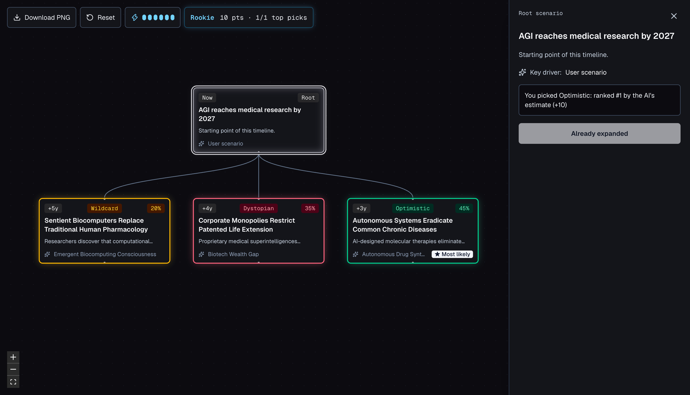

# WHAT IF? Timeline Run

WHAT IF? Timeline Run turns a "what if" question into a branching map of futures. You type a scenario, an AI model proposes three consequences (one optimistic, one dystopian, one wildcard), and you keep expanding the branches you find interesting. It is also a small game: before each expansion you guess which future the AI will rate most likely.

> Run this on your own machine only. The API routes have no login, and each request runs the `agy` CLI with your account. The `dev` and `start` scripts bind to `127.0.0.1` for that reason. Do not expose the server to a network or deploy it as is.



## How it plays

1. Start with your own scenario or one of four presets.
2. Select a node. To expand it, pick the category you think the AI will rate most probable, or skip the guess. Every expansion costs 1 energy.
3. Once the three branches appear, your pick is ranked against their probabilities: 10 points for the top one, 5 for the second, 2 for the third. A top pick refunds the energy.
4. A run starts with 6 energy. It ends when you reach an ending (a node four expansions down, worth 25 bonus points) or run out of energy. A summary card shows your score and the path you took.

Consecutive top picks build a streak, and your accuracy sets your rank: Rookie, Analyst, Strategist or Oracle. Note that a correct guess means agreeing with the model's own estimate, not with what is true.

Any node below the root also has two optional actions in the side panel. "Explain this probability" lists the factors that push the number up or down, and "Find evidence" returns up to three related web pages with short summaries.

## Requirements

- Node.js 20.9 or newer
- The Antigravity CLI (`agy`), installed and signed in. The app calls it as a child process, so there is no API key to configure.

## Run it locally

```bash
npm install
npm run dev
```

Then open http://127.0.0.1:3000.

## How the AI is called

Every expansion, explanation and evidence request runs `agy` in a fresh, empty temporary directory with `--mode plan --sandbox`, using the `gemini-3.8-flash-high` model. The route streams the agent's progress to the browser, so the side panel shows a live log and a timer, and the Cancel button stops the process. Output is constrained by a JSON schema and validated again on the server. Only one job runs at a time.

Expansion and explanation requests tell the model not to use tools. Only "Find evidence" lets it search the web, at most twice.

Because the app shells out to a local CLI, it works only on a machine where `agy` is installed and signed in. To deploy it, replace `runAgy` in `src/lib/agy.ts` with a call to a hosted model API.

A request usually takes between 20 seconds and a few minutes, and the timeout is 10 minutes. A full run to an ending needs at least four expansions, so plan for a long session.

## Tech

- Next.js 16 (App Router), React 19 and TypeScript
- Tailwind CSS 4, with animations written in plain CSS
- React Flow (`@xyflow/react`) for the canvas and Dagre (`@dagrejs/dagre`) for the tree layout
- `lucide-react` for icons and `html-to-image` for the PNG export

There is no database. The timeline and score live in the browser's `localStorage`, one timeline per browser.

## Project layout

```text
src/
  app/
    page.tsx                  game state and the agent job runner
    api/timeline/
      branch/                 three new branches for a node
      reasoning/              factors behind a node's probability
      evidence/               related web pages for a node
  components/
    canvas/                   React Flow canvas, node and edge components
    panels/                   scenario input, node drawer, run summary
  lib/
    agy.ts                    runs the agy CLI and streams its progress
    game.ts                   scoring, energy, streaks and ranks
    storage.ts                localStorage persistence and validation
    dagre-layout.ts           tree layout
  types/timeline.ts           shared types
```

## Checks

```bash
npm test            # unit tests for scoring, run state, storage and JSON parsing
npm run lint
npx tsc --noEmit
npm run build
```

The tests cover the pure logic only. The UI has no automated tests.

## Limitations

- Probabilities are the model's estimates. The explanations are reasoning from the model's own knowledge and are not verified.
- Source links in "Find evidence" come from search results and are resolved from Google redirect links. The summaries are the model's paraphrase, not quotes, and they relate to the reasoning rather than to the exact percentage.
- Response time depends heavily on the model and can vary a lot from one request to the next.

## Privacy

Your scenario and the branches leading to a node are sent to Google's Gemini model through `agy`. "Find evidence" also runs web searches built from the node. The app itself stores nothing on a server.

## Design notes

[`docs/ai_timeline_simulator_spec.md`](docs/ai_timeline_simulator_spec.md) is the original design contract: a strict tree, a linear lineage as the model's context, and Dagre for layout. The game mechanics, reasoning and evidence features were added after it was written.

The project was built with OpenCode. The rules and skills it used are in [CloudStriker/dotfiles](https://github.com/CloudStriker/dotfiles/).

## License

MIT. See [LICENSE](LICENSE).
